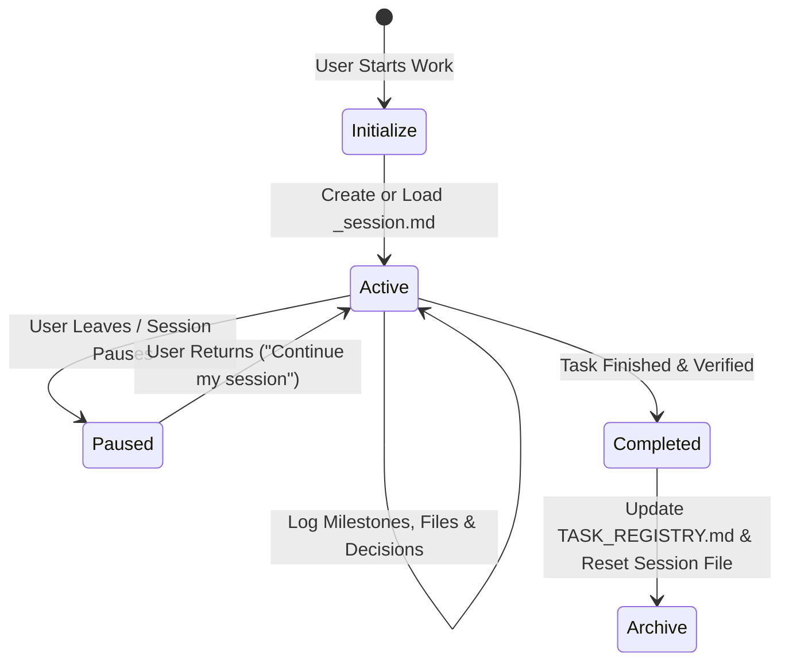

# Rule: Session Context & Resumption Protocol

## Purpose
Developers and contributors often switch tasks, take breaks, or return to an agent across multiple sessions. Without persistent session context, the agent loses track of in-flight changes, architectural decisions, and next steps, forcing the user to repeat themselves.

This rule mandates that every active session must maintain a dedicated session context file:
`c:/Users/anshul prajapati/OneDrive/Desktop/Snoopy/.context/sessions/<username>_session.md`

## Lifecycle of a Session Context File



## Mandatory Structure for `<username>_session.md`

```markdown
# Session Context: <username>

- **Active User:** `<username>`
- **Last Updated:** `YYYY-MM-DD HH:MM:SS`
- **Active Task ID:** `TASK-XXX`
- **Feature Name:** [docs/features/<feature>.md](file:///c:/Users/anshul%20prajapati/OneDrive/Desktop/Snoopy/docs/features/<feature>.md)
- **Status:** `IN_PROGRESS` | `PAUSED` | `AWAITING_REVIEW` | `COMPLETED`

---

## 1. Current Objective & User Goal
<Clear summary of what the user is working on right now>

## 2. In-Flight Progress & Milestones Completed
- [x] Step 1: ...
- [x] Step 2: ...
- [ ] Step 3 (Current Focus): ...
- [ ] Step 4: ...

## 3. Files Touched / In-Progress Changes
- [path/to/file1.ext](file:///c:/Users/anshul%20prajapati/OneDrive/Desktop/Snoopy/path/to/file1.ext) — What was changed or is in progress.
- [path/to/file2.ext](file:///c:/Users/anshul%20prajapati/OneDrive/Desktop/Snoopy/path/to/file2.ext) — Pending edits.

## 4. Key Architectural Decisions Made
- Decision 1: ...
- Decision 2: ...

## 5. Next Immediate Action Upon Resumption
<Exact concrete step to perform as soon as the session resumes>

## 6. One-Line Resumption Trigger
> *"Agent, resume my active session for TASK-XXX (<feature name>) from where I left off."*
```

## Agent Resumption Behavior
When a user says:
- *"I'm back"*
- *"Continue from where we left off"*
- *"What were we doing?"*
- *"Resume my task"*

The agent **MUST**:
1. Locate and read `.context/sessions/<username>_session.md`.
2. Inspect `Next Immediate Action Upon Resumption` and `Current Focus`.
3. Verify git status and check modified files.
4. Output a brief status recap to the user:
   > "Welcome back, `<username>`! We were working on **`<Feature>`** (`<Task ID>`).  
   > Milestones completed: `<X>`.  
   > Next immediate step is: `<Next Step>`.  
   > Shall I proceed with `<Next Step>`?"
5. Immediately execute the next step upon confirmation without asking the user to re-explain anything.
