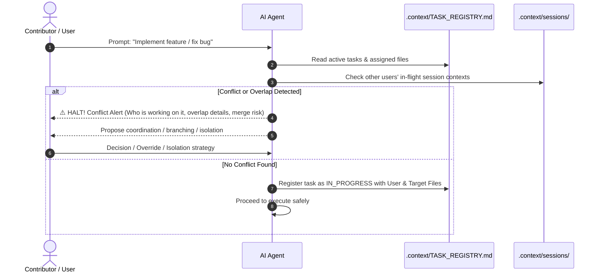

# Rule: Task Collision & Code Merge Conflict Prevention Protocol

## Purpose
When multiple developers, contributors, or agents work on Snoopy simultaneously, overlapping edits can cause severe merge conflicts, overwrite in-flight work, or duplicate effort. This rule mandates automated collision detection before any code is written.

## Master Tracking File
All active, pending, and completed tasks must be recorded in:
`c:/Users/anshul prajapati/OneDrive/Desktop/Snoopy/.context/TASK_REGISTRY.md`

## The Pre-Execution Gate (MANDATORY)

Before creating or editing any files for a requested task, the agent **MUST** perform the following collision check:



### Detailed Check Procedure:
1. **Read Task Registry**: Read `.context/TASK_REGISTRY.md`.
2. **Inspect Active Sessions**: Look at all files in `.context/sessions/` for tasks currently marked `IN_PROGRESS`.
3. **Compare Scope**:
   - Is another user working on the exact same feature or prompt?
   - Will the proposed task modify files that another user currently has open or is actively modifying?
   - Is there a related pull request or unmerged branch touching these modules?

### If Conflict / Overlap is Detected:
The agent **MUST NOT** proceed silently. It must output an explicit conflict warning banner:

```markdown
> ⚠️ **MERGE COLLISION & TASK CONFLICT ALERT**
>
> - **Requested Task:** <Task Name / Description>
> - **Conflicting Task:** <Existing Task in Registry>
> - **Currently Assigned To:** `<Other User Name>` (Status: `IN_PROGRESS`)
> - **Colliding Files / Modules:** `<List of overlapping files>`
> - **Collision Risk:** Direct modification will result in severe Git merge conflicts or duplicate implementation!
>
> **Recommended Actions:**
> 1. Check with `<Other User Name>` before touching these files.
> 2. Create an isolated sub-branch or work on an independent sub-module that does not conflict.
> 3. Wait until `<Other User Name>` finishes and marks the task `COMPLETED` in `.context/TASK_REGISTRY.md`.
```

The agent must pause and await user direction unless the user explicitly tells the agent to proceed with an isolated strategy.

### If No Conflict Exists (or Conflict Resolved):
1. Register the task entry into `.context/TASK_REGISTRY.md`:
   - `Task ID`: Unique sequential ID (e.g., `TASK-001`, `TASK-002`)
   - `Feature`: Linked to `docs/features/<feature>.md`
   - `Assigned To`: Username
   - `Target Files`: Comma-separated list of expected files to edit/create
   - `Status`: `IN_PROGRESS`
   - `Branch / Session`: Working branch or session ID
   - `Started At`: Timestamp
2. Proceed with task implementation.
3. Upon task completion, update status to `COMPLETED` and record the completion timestamp and commit/summary.
