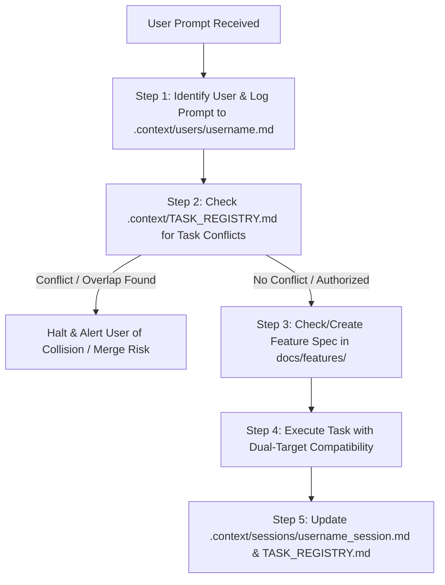

# SNOOPY AGENT OPERATING RULES & PROTOCOLS
> **Project:** Snoopy (Scam-Checking Tool by DETOX)  
> **Target Platforms:** Dual Target — Standalone Application & Android Studio Published Application  
> **Standard:** Mandatory instructions for all AI Agents and contributors operating within this repository.

---

## 1. Core Principles & Dual-Target Architecture

All development in this repository must support two release targets seamlessly:

1. **Standalone Application**:
   - Runs independently (e.g., modern responsive Web App, Desktop/PWA, or standalone Node/browser engine).
   - Can be tested and executed locally without mobile toolchains.
   - Core scam detection engine, heuristics, pattern matching, URL analyzers, and UI components must be platform-agnostic.

2. **Android Studio Published Application**:
   - Converted, bundled, signed, and published via Android Studio for Android / Google Play Store.
   - Integrates platform-specific capabilities (e.g., SMS monitoring, notification listener, Android share intents, system clipboard access, local Android secure storage, background services).
   - Any mobile-specific bindings (e.g., Capacitor, React Native, Kotlin / Java bridges, WebViews, or Android Gradle configurations) must live in designated adapter directories (`/android` or platform wrappers) without polluting core standalone logic.

### Architectural Rule:
- **Strict Separation of Concerns**: Core scam detection algorithms and UI views must NEVER directly import or hard-code Android-exclusive SDKs (`android.*`). Use abstraction layers and dependency injection (e.g., `PlatformAdapter.getClipboard()`, `NotificationService.notify()`) with a fallback for the standalone environment.
- Any change to core features must be verified for compatibility on **both** standalone execution and the Android build pipeline.

---

## 2. Mandatory Protocols for Every Agent Session

Every AI Agent operating in this repository **MUST** execute the following five-step workflow on every interaction:



---

### Step 1: User Logging Protocol (`.context/users/<username>.md`)
- **Requirement**: The agent must record all user prompts, requirements, explanations, and decisions into a single dedicated markdown file for that user:
  `c:/Users/anshul prajapati/OneDrive/Desktop/Snoopy/.context/users/<username>.md`
- **Username Resolution Order**:
  1. Explicitly provided username in the conversation.
  2. Git user name (`git config user.name`, sanitized to lowercase snake_case, e.g., `anshul_prajapati`).
  3. Environment user name (`$env:USERNAME` or `$USER`).
- **File Content**:
  - User profile & preferences.
  - Chronological log of sessions, prompts (verbatim or summarized), architectural decisions requested, and agent outputs.
  - Never overwrite prior history; always append with date/timestamps.

---

### Step 2: Task Collision & Code Merge Conflict Prevention (`.context/TASK_REGISTRY.md`)
- **Requirement**: Before modifying or creating code for any feature or bug, the agent **MUST** inspect `.context/TASK_REGISTRY.md` and active session files in `.context/sessions/`.
- **Conflict Matching Criteria**:
  - Is another user or branch actively working on the same task or feature?
  - Are the planned target files currently marked as `IN_PROGRESS` by someone else?
  - Do the prompts express identical or overlapping feature implementations?
- **Conflict Handling Action**:
  - If a collision or overlap is detected:
    1. **PAUSE IMMEDIATELY** before writing or modifying code.
    2. **ALERT THE USER EXPLICITLY**:
       > ⚠️ **MERGE CONFLICT & TASK COLLISION WARNING**  
       > **Task/Feature:** `<Feature Name>` is already assigned to or being actively modified by **`<Other User>`** (Branch / Session: `<details>`).  
       > Modifying these files (`<file_list>`) will cause severe merge conflicts or duplicated work!
    3. **Propose Solutions**:
       - Coordinate with `<Other User>` or pull/merge their latest branch first.
       - Scope this task to an isolated sub-module or separate branch.
       - Wait until `<Other User>` marks the task `COMPLETED` in `.context/TASK_REGISTRY.md`.
    4. Only proceed if the user explicitly confirms how the conflict is handled or overrides with an isolation strategy.
- **Registration**: Once cleared, log the new task in `.context/TASK_REGISTRY.md` with status `IN_PROGRESS`.

---

### Step 3: Feature-Specific Workflow & Architecture Documentation (`docs/features/<feature_name>.md`)
- **Requirement**: Every single feature in Snoopy must have its own dedicated markdown file in `docs/features/`.
- **Specification Template**: Use `docs/features/TEMPLATE_FEATURE.md`.
- **Mandatory Sections in Feature File**:
  1. **Feature Overview**: Business objective, problem solved, scam red flag addressed.
  2. **Architecture Blueprint**: Core modules, data contracts, and platform boundary.
  3. **Workflow & Logic Flow**: User journey, inputs, analysis engine flow, and output alerts (with Mermaid diagrams).
  4. **Dual-Target Execution Matrix**:
     - *Standalone behavior*: How the feature works in the web/desktop standalone app.
     - *Android Studio behavior*: How the feature hooks into Android native APIs, permissions, services, and Google Play policies.
  5. **File Map**: Specific files implementing or touching this feature.
  6. **Security & Privacy**: Handling of sensitive user URLs, messages, and fraud report data.

---

### Step 4: Active Task Execution & Quality Standards
- Write clean, maintainable, modular code adhering to the feature's architecture spec.
- Maintain documentation integrity: Never strip existing comments or docstrings.
- Ensure all file paths and symbols are hyperlinked using GitHub-style markdown links (`[filename](file:///path/to/file)`).
- Preserve backwards compatibility with both the standalone runner and the Android build tree.

---

### Step 5: Session Context & Resumption Protocol (`.context/sessions/<username>_session.md`)
- **Requirement**: Maintain a persistent session context file for each active user:
  `c:/Users/anshul prajapati/OneDrive/Desktop/Snoopy/.context/sessions/<username>_session.md`
- **Purpose**: Enables the user or another agent to seamlessly resume work at any time without repeating instructions or losing state.
- **Mandatory Fields in Session File**:
  - `Last Updated`: Timestamp.
  - `Active Feature / Task`: The exact task being worked on.
  - `Current Status`: (`IN_PROGRESS`, `PAUSED`, `AWAITING_REVIEW`, `READY_FOR_MERGE`).
  - `Completed in this Session`: Bullet list of accomplishments.
  - `Files Modified / Created`: File links with line ranges or descriptions.
  - `Decisions & Notes`: Key technical choices made during the session.
  - `Next Immediate Step`: Exact step to execute when resuming.
  - `Resume Instructions`: One-line prompt for the user to paste when returning (e.g., *"Resume task: Suspicious Link Classifier in docs/features/check_suspicious_links.md"*).
- When a task completes, update `.context/TASK_REGISTRY.md` to `COMPLETED` and clear or archive the session context.

---

## 3. Directory Layout Standards

```text
Snoopy/
├── AGENTS.md                         # Master Agent Operating Rules (This file)
├── GEMINI.md                         # IDE Agent Rule Mirror
├── Readme.md                         # Project Overview
├── .agents/
│   └── rules/                        # Modular rule specifications
│       ├── dual_target_architecture.md
│       ├── user_logging.md
│       ├── task_collision_prevention.md
│       ├── feature_architecture.md
│       └── session_continuation.md
├── .context/
│   ├── TASK_REGISTRY.md              # Central task tracking & collision detection
│   ├── users/                        # Dedicated user prompt and explanation logs
│   │   └── <username>.md
│   └── sessions/                     # Persistent session context files for resumption
│       └── <username>_session.md
├── docs/
│   └── features/                     # Feature workflow and architecture blueprints
│       ├── TEMPLATE_FEATURE.md       # Standard feature specification template
│       ├── standalone_vs_android_architecture.md
│       ├── detect_red_flags.md
│       ├── check_suspicious_links.md
│       └── analyze_suspicious_messages.md
├── core/                             # Platform-agnostic scam detection engine & models
├── standalone/                       # Standalone application build & test harness
└── android/                          # Android Studio project & native packaging
```

---

## 4. Conflict Resolution Quick Checklist

Before running any code edit tool, ask:
1. [ ] Did I read `.context/TASK_REGISTRY.md`?
2. [ ] Is anyone else touching these files?
3. [ ] If yes, did I warn the user and get a merge conflict mitigation plan?
4. [ ] Did I log the user's prompt in `.context/users/<username>.md`?
5. [ ] Is there a feature spec in `docs/features/`?
6. [ ] Did I update `.context/sessions/<username>_session.md`?
