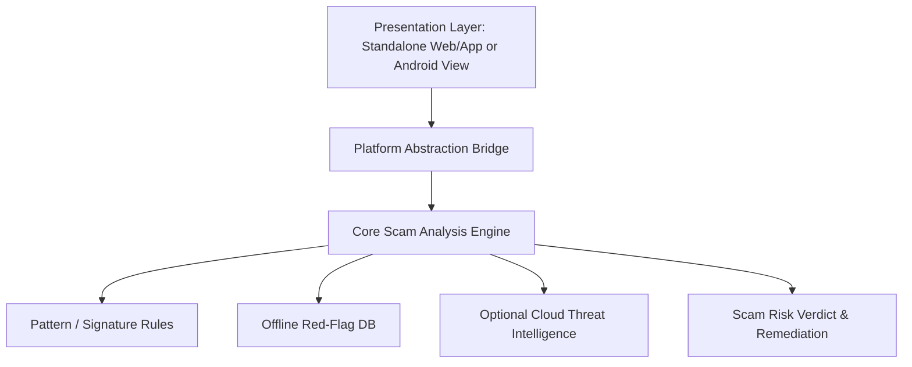
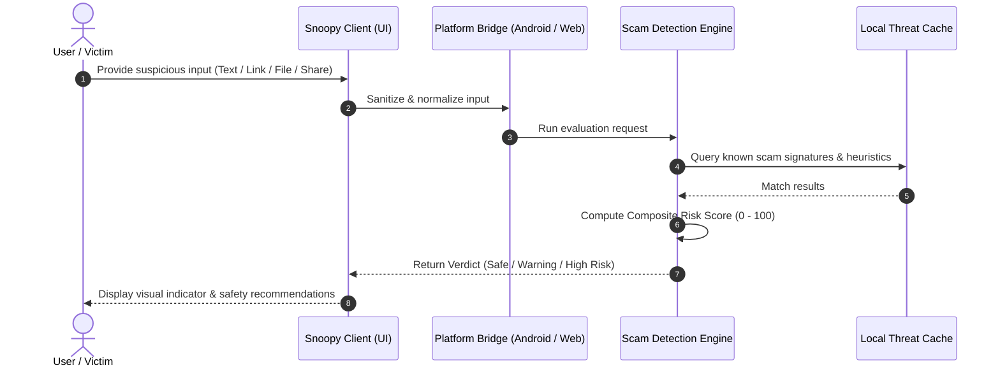

# Feature Specification: <Feature Name>
> **Feature ID:** `FEAT-XXX`  
> **Status:** `PROPOSED` | `IN_DESIGN` | `IN_DEVELOPMENT` | `ACTIVE` | `DEPRECATED`  
> **Lead / Owner:** `<username>`  
> **Target Release:** Standalone & Android Studio (Google Play)  
> **Parent Architecture:** [standalone_vs_android_architecture.md](file:///c:/Users/anshul%20prajapati/OneDrive/Desktop/Snoopy/docs/features/standalone_vs_android_architecture.md)

---

## 1. Executive Summary & Problem Statement
- **What scam problem does this feature solve?**  
  *<Explain the scam vector: phishing, impersonation, fake investment, OTP theft, malicious APK, etc.>*
- **User Experience Goal:**  
  *<What does the user see, input, and receive? E.g., instant risk score, warning banner, actionable advice.>*

---

## 2. System Architecture Blueprint

### 2.1 Component Breakdown

- **Core Engine Module (`/core/features/...`)**: Platform-neutral analysis, rule evaluation, scoring algorithm.
- **Standalone Runner (`/standalone/...`)**: Direct integration, mock services, test runner.
- **Android Studio Bridge (`/android/...`)**: Native integration, system services, permissions.

---

## 3. End-to-End Workflow & Data Flow

---

## 4. Dual-Target Implementation Matrix

| Capability / Concern | Standalone Application | Android Studio Published App |
| :--- | :--- | :--- |
| **Input Ingestion** | Manual copy-paste, drag-and-drop, CLI input | Android Share Intent ("Share with Snoopy"), Clipboard Listener |
| **Execution Environment** | Node.js / Browser Web Worker | Android Background Service / WorkManager |
| **Offline Storage** | IndexedDB / Local filesystem | Android Room Database / SQLite / EncryptedSharedPreferences |
| **Notifications** | Browser Notification API / Console alerts | Android NotificationManager with high-priority safety channels |
| **Required Permissions** | None (Standard browser permissions) | Android permissions (documented in `AndroidManifest.xml`) |
| **Google Play Compliance** | N/A | Full disclosure of data processing; No unauthorized background SMS reading |

---

## 5. File Map & Code Ownership

- **Core Logic:**
  - `core/features/<feature>/engine.ts` (or `.py` / `.js`)
  - `core/features/<feature>/types.ts`
  - `core/features/<feature>/rules.json`
- **Standalone:**
  - `standalone/src/components/<FeatureComponent>.*`
- **Android Studio:**
  - `android/app/src/main/java/com/detox/snoopy/features/<FeatureBridge>.kt`
  - `android/app/src/main/res/layout/...`
- **Tests:**
  - `tests/core/<feature>_test.*`

---

## 6. Security, Privacy & False Positive Mitigation
- **PII Sanitization**: Strip phone numbers, names, and passwords before any remote lookup.
- **False Positive Protection**: Clear disclaimers and multi-factor rule verification before flagging legitimate domains/messages.
- **Disclaimer Enforcement**: Display Detox safety disclaimer: *"Snoopy helps identify scam patterns but cannot guarantee safety."*
