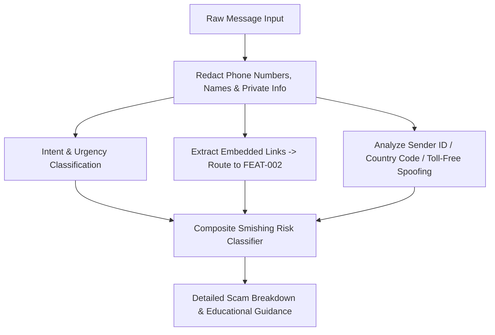

# Feature Specification: Analyze Suspicious Messages
> **Feature ID:** `FEAT-003`  
> **Status:** `ACTIVE`  
> **Lead / Owner:** `DETOX Core Team`  
> **Target Release:** Standalone & Android Studio  
> **Parent Architecture:** [standalone_vs_android_architecture.md](file:///c:/Users/anshul%20prajapati/OneDrive/Desktop/Snoopy/docs/features/standalone_vs_android_architecture.md)

---

## 1. Executive Summary & Objective

The **Analyze Suspicious Messages** engine detects smishing (SMS phishing), fraudulent messaging app outreach (WhatsApp, Telegram, iMessage), social engineering tactics, and impersonation attempts.

### Common Scam Types Analyzed:
- **Delivery & Package Scams**: *"Your parcel cannot be delivered until you pay $2.50 fee at [link]"*.
- **Banking / Account Freezes**: *"URGENT: Your account has been temporarily disabled due to suspicious activity. Verify now"*.
- **Part-Time / High-Pay Job Scams**: *"Earn $300-$800 daily working from home liking YouTube videos / completing simple online tasks"*.
- **Family Emergency / "Hi Mum" Fraud**: *"Hi Mum, lost my phone, this is my new temporary number, can you pay a bill for me?"*.
- **Tax / Government Rebates**: Impersonation of IRS, HMRC, India Income Tax, etc., claiming immediate tax refunds.

---

## 2. Architecture & Natural Language Scam Pipeline

---

## 3. Workflow & User Journey

1. **Input Submission**:
   - *Standalone*: Copy-paste the SMS or message into Snoopy's message analyzer input.
   - *Android App*: Tap "Copy" on any message, open Snoopy (which detects copied text via clipboard prompt), or share directly from the messaging client.
2. **Safety Normalization**:
   - Replaces user personal numbers and credentials with generic tokens (`[PHONE_NUMBER]`, `[NAME]`).
3. **Compound Analysis**:
   - Evaluates linguistic cues: artificial panic, excessive punctuation (`!!!`), requests to switch to private channels (Telegram/WhatsApp), and promise of unearned wealth.
   - Evaluates embedded URLs using the **Check Suspicious Links** engine ([FEAT-002](file:///c:/Users/anshul%20prajapati/OneDrive/Desktop/Snoopy/docs/features/check_suspicious_links.md)).
4. **Scam Anatomy Output**:
   - Visual breakdown highlighting the specific sentences that represent scam techniques.
   - Direct explanation: *"Why this is dangerous"*.
   - Next steps: How to report the number to telecommunications providers and how to block the sender safely.

---

## 4. Dual-Target Execution Matrix

| Capability | Standalone Application | Android Studio Published App |
| :--- | :--- | :--- |
| **Input Delivery** | Text area with sample scam message templates for testing | Android Share Sheet, one-tap Clipboard paste |
| **Notification Integration** | Browser notifications | Android High-Priority Security Notification |
| **Permissions** | None | Standard Internet & Notification permissions. Avoid invasive `READ_SMS` permission to maintain Google Play compliance and preserve user trust. |
| **Storage** | Local browser storage for past analysis history | Android Room Encrypted DB for saved threat queries |

---

## 5. Security & Privacy
- **Strict User Privacy**: Snoopy analyzes messages ephemerally. Message contents are not uploaded to public servers without explicit user confirmation for threat reporting.
- **Privacy Policy Compliance**: Complies with Google Play User Data policies regarding private communications.
