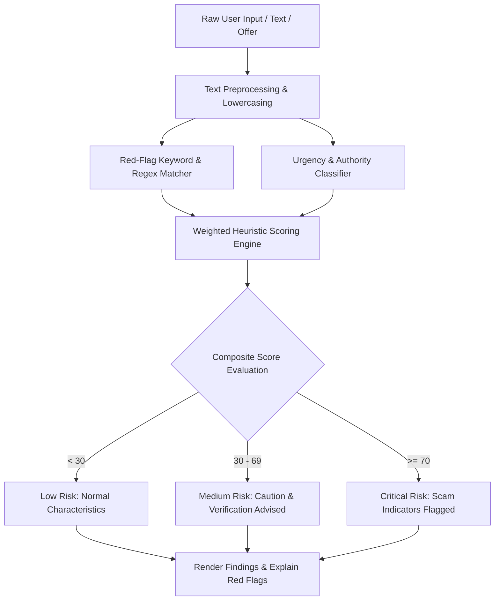

# Feature Specification: Detect Red Flags
> **Feature ID:** `FEAT-001`  
> **Status:** `ACTIVE`  
> **Lead / Owner:** `DETOX Core Team`  
> **Target Release:** Standalone & Android Studio  
> **Parent Architecture:** [standalone_vs_android_architecture.md](file:///c:/Users/anshul%20prajapati/OneDrive/Desktop/Snoopy/docs/features/standalone_vs_android_architecture.md)

---

## 1. Executive Summary & Objective

The **Detect Red Flags** engine is Snoopy's primary rule and heuristics evaluator. It inspects arbitrary user input (text excerpts, conversational claims, email subjects, job offers, prize notifications, urgent requests) to identify hallmark indicators of fraudulent schemes.

### Core Red Flags Detected:
- **Artificial Urgency & Panic**: *"Account suspended in 24 hours"*, *"Immediate payment required to avoid arrest"*.
- **Unsolicited Financial Windfalls**: Lottery winnings, inheritance claims, guaranteed 500% cryptocurrency returns.
- **Payment Method Anomalies**: Demands for non-refundable payments via Gift Cards (Apple/Google Play/Steam), wire transfers, or unverified crypto addresses.
- **Authority Impersonation**: Posing as government tax agencies, law enforcement, technical support, or bank fraud departments.
- **Credential & Secret Requests**: Demands for passwords, 2FA codes, PINs, or One-Time Passwords (OTPs).

---

## 2. Architecture & Pipeline

---

## 3. Workflow & User Journey

1. **Input Submission**:
   - *Standalone*: User enters suspicious text into the Snoopy web/desktop input area.
   - *Android App*: User selects text in any messaging app, taps "Share", and selects "Check with Snoopy", or pastes from clipboard.
2. **Analysis Execution**:
   - The input is sanitized (all emails, credit card numbers, and phone numbers are redacted).
   - Core heuristic rules evaluate presence of urgency keywords, financial demands, and impersonation flags.
3. **Verdict Generation**:
   - Returns a structured verdict:
     - `overallScore`: 0 to 100
     - `riskLevel`: `LOW` | `MEDIUM` | `HIGH`
     - `matchedRedFlags`: Array of detected reasons (e.g., *"Requests Gift Card payment"*, *"Creates artificial time pressure"*).
     - `recommendations`: Actionable steps (e.g., *"Do not share OTP"*, *"Verify through official website"*).

---

## 4. Dual-Target Execution Matrix

| Capability | Standalone Application | Android Studio Published App |
| :--- | :--- | :--- |
| **Trigger Mechanism** | Interactive text area / direct input form | Android Intent filter (`ACTION_SEND`, `text/plain`) & Clipboard paste button |
| **Rule Storage** | Local JSON rules bundle in `/core/rules/red_flags.json` | Bundled in assets + cached in Android internal storage |
| **Response Display** | Reactive Web component with high-contrast warning cards | Native Android Compose card / Dialog with vibration haptics on high risk |
| **Offline Support** | 100% offline rule matching | 100% offline rule matching |

---

## 5. Security & Privacy
- **Zero Cloud Leakage for Sensitive Tokens**: Snoopy redacts any detected OTP or password before evaluation.
- **Safety Disclaimer**: Prominently displays: *"Snoopy is designed to assist with scam awareness and detection. It cannot guarantee that a website, link, or message is safe or fraudulent."*
